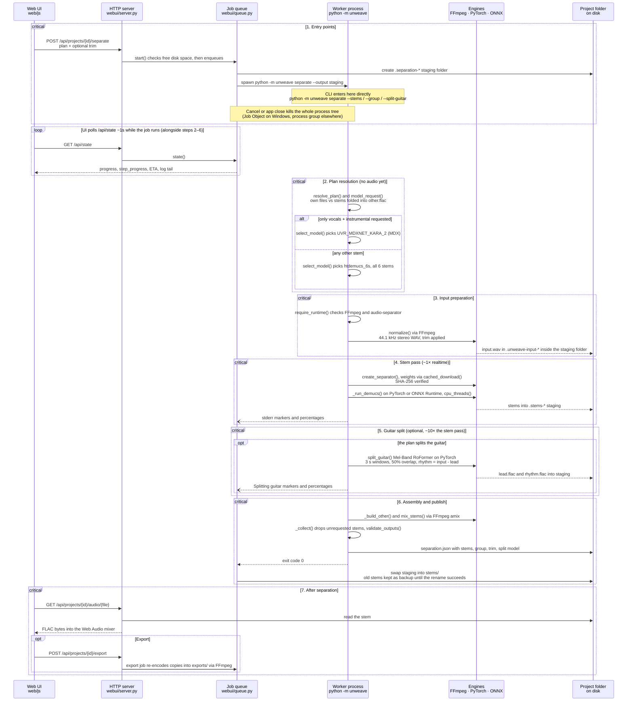

# Architecture — Unweave

Unweave separates a song into stems on the local machine. One Python package does the
work (`unweave/`), a stdlib HTTP server exposes it, and a vanilla-JS frontend drives
it. No audio leaves the computer; the only network traffic is model downloads, YouTube
imports, and MusicBrainz lookups when you ask for them.

## Contents

1. [Data flow](#data-flow)
   - [Sequence](#sequence)
   - [Stage details](#stage-details)
   - [Where the time goes](#where-the-time-goes)
2. [Design rules](#design-rules)
3. [Module responsibilities](#module-responsibilities)
   - [`audio/`](#audio)
   - [`webui/`](#webui)
   - [`projects/`](#projects)
   - [Top-level modules](#top-level-modules)
4. [Models](#models)
5. [Frontend (`web/`)](#frontend-web)
6. [Dependencies](#dependencies)

---

## Data flow

One separation, from the click to the mixer. The browser never calls the pipeline
directly: the server queues a job, the job runs `python -m unweave` in its own
process, and that worker reports progress on stderr (the queue reads the stream
line by line). The UI learns status by polling `GET /api/state` (~1 s while busy).
The command line enters at the same worker step. Labeled blocks below are the
seven stages.

### Sequence

### Stage details

What the arrows leave out, by stage:

| Stage | Detail |
|---|---|
| 2 | `htdemucs_6s` always emits all six stems, even when only four are kept; MDX is the only model that can emit `instrumental`. |
| 3 | A CLI run on a YouTube URL downloads first via `youtube_audio()` (yt-dlp). In the app, YouTube is its own import job that creates the project before separation. |
| 4 | Models are fetched once by `cached_download()` and checked against a pinned SHA-256 on every load. ONNX Runtime is CPU-only here. |
| 6 | `mix_stems()` uses `amix` with `normalize=0` and writes 24-bit FLAC, so a folded `other.flac` can exceed full scale without clipping. `validate_outputs()` refuses a truncated or non-finite stem set. |
| 6 | Publishing is two renames: the worker fills the job's staging folder, then the queue swaps it into `stems/`, restoring the backup if that fails. A failed or cancelled job never leaves half a stem set. |

### Where the time goes

Measured on an i5-12400 with no GPU, on a 355-second track. The numbers the plan dialog
shows (`~1x`, `~10x`, `<1 s`) come from this table. They are CPU figures: the MDX wheel is
CPU-only, and a CUDA card accelerates the PyTorch passes much more than the ONNX one, so
on GPU hardware the split is a smaller multiple than this.

| Stage | Function | Cost |
|---|---|---|
| Stem pass | `_run_demucs()` | ~0.22 s per second of audio (~1x) |
| Guitar split | `split_guitar()` | ~2.4 s per second of audio (~10x) |
| Mix into `other.flac` | `mix_stems()` | under a second |

A plain 6-stem separation therefore costs about the length of the song, and the guitar
split costs roughly ten times that. Each step reports its own percentage for this reason:
one shared bar would sit motionless through the entire split.

---

## Design rules

These are the non-obvious decisions; most bugs in this area came from breaking one.

- **One model for every multi-stem plan.** `select_model()` only picks the MDX karaoke
  model when the request is *nothing but* `vocals`/`instrumental`, because no Demucs
  model can emit `instrumental`. Everything else runs `htdemucs_6s`, so `other` always
  means the same six-stem residual. An earlier 4-stem fallback silently folded guitar and
  piano into `other`, which made identical tick-boxes produce different audio.
- **Compute once, then drop.** The 6-stem model emits all six stems in a single pass;
  stems the plan neither keeps nor folds are discarded by `_collect()` after inference.
  Switching models to "save work" would change the audio, which is worse than doing a
  little extra inference.
- **Publish atomically.** Inference writes into a staging folder inside the project.
  Existing stems are renamed to a backup, then staging is renamed into place; if that
  rename fails the backup is restored. A failed or cancelled run never leaves a project
  with half a stem set.
- **Scratch stays inside the job's staging folder.** Even the normalised `input.wav`
  lives there (`.unweave-input-*`), not in `%TEMP%`, so an interrupted job leaves
  nothing behind that the leftover scan (`cleanup.py`) can't find.
- **Child processes die with the job and with the app.** Every subprocess starts through
  `processes.popen()`: a kill-on-close Job Object on Windows, a process group elsewhere.
  Cancel, close and even a crash end the worker and anything it started (FFmpeg, yt-dlp).
- **Check space before writing.** Separation, export and import call
  `require_free_space()` with a size estimate before starting, and again when a queued
  job actually starts.
- **Two progress numbers per job.** `progress` is the overall 0-100 (nav pill, queue bar,
  library badge, detail “Whole job” line), mapped from measured inference
  elapsed/(elapsed+ETA) so it tracks wall-clock; when a guitar pass is still queued, a
  ~10× prior projects it, then real guitar timing takes over. `step_progress` /
  `step_eta` drive the detail ring and “Step time left”; dual-pass jobs also expose
  `pass_index` / `pass_count` and `eta_estimated` so the panel stays step-first.
  Steps are `prepare`, `load`, `separate`, `guitar`, `finalize`, derived from markers
  the CLI prints on stderr. Full rules:
  [09 — Job progress and ETA](specs/09-job-progress.md).
- **Every job leaves a log.** `<config dir>/logs/<stamp>-<kind>-<id>.log` (override with
  `UNWEAVE_LOG_DIR`) records the exact command, every raw output line including the
  progress lines the UI hides, and a closing status. The in-memory log is trimmed and
  dies with the server, so this file is what makes a cancelled or failed run diagnosable.
- **Leave a core free.** `cpu_threads()` keeps one core for the server and UI, and caps
  the job concurrency at one on CPU-only machines (`_derive_max_concurrent_jobs()`).
  When a CUDA build allows parallel jobs, each gets an equal share via `UNWEAVE_THREADS`.
- **The UI process never imports torch.** CUDA support is read from the installed
  files (`setup_env.torch_has_cuda()`), so the long-running server stays small.

---

## Module responsibilities

### `audio/`

- `pipeline.py` — the whole separation path. `model_request()` / `resolve_plan()` turn
  the flags into a plan, `select_model()` picks the network, `normalize()` converts to
  44.1 kHz stereo 16-bit PCM with a 5 ms fade at trim edges, `_run_demucs()` runs
  inference, `_run_guitar_split()` adds the lead/rhythm pass, `_build_other()` and
  `mix_stems()` fold group members via FFmpeg `amix`, `_collect()` decides what is
  published, and `separate()` sequences all of it.
- `guitar_split.py` — `split_guitar()`. Loads the vendored Mel-Band RoFormer from
  `vendor/roformer`, predicts lead over 3-second windows at 50% overlap with a fade
  window, and derives rhythm as input minus lead. Threads come from `cpu_threads()`.
- `model_cache.py` — `cached_download()` fetches and SHA-256-verifies weights;
  `BUILTIN_MODELS` lists the Demucs/MDX models `audio-separator` knows how to build;
  `create_separator()` instantiates it with our parameters.
- `exports.py` — `export_stems()` and `convert()`. `FORMATS` covers flac, mp3, opus, m4a,
  wav16 and aiff; `LIMITER` (`alimiter`, ceiling ≈ −1 dBFS) backs the "prevent clipping"
  option, and tags are written through `-metadata`.
- `output_files.py` — `validate_outputs()` rejects truncated or non-finite files before
  anything is published.
- `sources.py` — yt-dlp wrappers: `youtube_url()` validates, `youtube_command()` builds
  the argv, `youtube_audio()` extracts to a temp WAV.

### `webui/`

- `server.py` — stdlib `http.server` on 127.0.0.1:8765 with a per-session token header.
  Everything outside `/api/` is a static file from `web/`. API dispatch goes through a
  tiny Express-style `router.py`; handlers are registered in `routes/`
  (`system`, `meta`, `projects`, `window`).

  | Area | Module | Routes |
  |---|---|---|
  | State / library / jobs / setup / storage / updates | `routes/system.py` | `GET /api/state`, `GET /api/startup`, `POST /api/library`, `GET /api/folders`, `POST /api/import`, `POST /api/import-youtube`, `POST /api/cancel`, `POST /api/setup/start`, storage + cleanup + updates |
  | Song info lookup | `routes/meta.py` | `POST /api/metadata/search`, `POST /api/metadata/prepare`, `GET /api/metadata/cover/{token}` |
  | Per song | `routes/projects.py` | `POST /api/projects/{id}/separate`, `…/split-guitar`, `…/export`, `…/metadata`, `…/delete`, `…/clear-exports`, `…/reveal`; `GET …/audio/{file}`, `…/original`, `…/cover` |
  | Desktop window | `routes/window.py` | `GET /api/window/bounds`, `POST /api/window/{action}` |

- `progress.py` — parse CLI/stderr markers and tqdm bars into `progress` / `step_progress` / ETA.
- `plans.py` — stem-plan validation (`selection_stems`, `plan_stems`, `validate_group`).
- `queue.py` — `JobQueueMixin`: enqueue/drain/workers/cancel (mixed into `Library`).
- `settings.py` — `SettingsMixin`: updates prefs, leftover cleanup, storage sizes.
- `library.py` — thin façade (`Library`) for root/state/window; owns shared lock and job lists.
  Job workers live on `JobQueueMixin` (`queue.py`): up to a RAM/GPU-derived cap, each
  spawns `python -m unweave`, reads stderr/stdout, updates progress via `progress.py`.
  `JobLog`, import/delete/export, and disk-space checks sit with the queue; Settings
  storage numbers/clears and the leftover scan sit on `SettingsMixin` (`settings.py`).

### `projects/`

- `store.py` — the on-disk project format and safe operations: `import_project()`,
  `describe_project()`, `list_projects()`, `save_metadata()`, `apply_enrichment()`,
  `cover_path()`, plus `atomic_json()` for crash-safe writes and `probe_audio()` to
  reject unreadable files.
- `metadata.py` — MusicBrainz search and Cover Art Archive images, rate-limited to one
  request per second. Only the text fields are sent.

### Top-level modules

- `cli.py` / `__main__.py` — `python -m unweave` (`separate`, `split-guitar`, `export`,
  `ui`). The worker process every job runs.
- `setup_env.py` — first-run dependency detection and installation. `runtime_ok()`,
  `ffmpeg_ok()`, `separation_ok()` and `youtube_ok()` probe the environment;
  `STAGE_ORDER` is `ffmpeg`, `separation`, `youtube`; `run_setup()` reports on the shared
  progress band (0-90 across the stages, the last 10 for verification), and with
  `repair=True` reinstalls stages that are already present. Downloads are size-capped.
- `cleanup.py` — the leftover scanner and cleaner (spec 13): known name patterns in
  `%TEMP%`, the projects folder and the model cache only, older than 24 h, never while a
  job runs, never through links, re-checked right before each delete.
- `fsutil.py` — `is_link_like()` (symlinks and junctions, but not OneDrive cloud files)
  and `dir_bytes()`, shared by storage sizing and clean-up.
- `processes.py` — `popen()` / `stop()`: every child process, killable as a tree.
- `tools.py` — paths, FFmpeg discovery, `cpu_threads()`, `total_ram_gb()`,
  `require_free_space()`, `app_version()`.
- `updates.py` — the GitHub Releases lookup behind the update check (spec 10).

---

## Models

| Model | File | Output | Backend | Chosen when |
|---|---|---|---|---|
| htdemucs_6s | `htdemucs_6s.yaml` + `5c90dfd2-34c22ccb.th` | vocals, drums, bass, guitar, piano, other | PyTorch (Demucs) | the default for every multi-stem plan |
| UVR_MDXNET_KARA_2 | `UVR_MDXNET_KARA_2.onnx` | vocals, instrumental | ONNX Runtime (CPU) | only the karaoke pair is requested |
| htdemucs | `htdemucs.yaml` + `955717e8-8726e21a.th` | vocals, drums, bass, other | PyTorch (Demucs) | only via an explicit `--model`; never auto-selected |
| lead_rhythm_listra92 | `lead_rhythm_listra92.ckpt` | lead, rhythm | PyTorch (RoFormer) | `--split-guitar` / the plan enables the split |

Weights live in `%LOCALAPPDATA%\Unweave\models` in an installed app
(`~/.cache/unweave/models` on Linux, `.sound-razor/models/` in a dev checkout, or
`--cache`) and are verified against a pinned SHA-256 on every load, so a corrupted or
swapped file fails loudly instead of producing garbage audio.

---

## Frontend (`web/`)

Vanilla ES modules, no build step. `js/app.js` wires everything; the rest is grouped by
role:

| Folder | Modules |
|---|---|
| `js/core/` | `store.js` (state), `core.js` (API calls and the session token), `constants.js`, `i18n.js` (every string in English and Vietnamese) |
| `js/chrome/` | the frame around the views: `navigation.js`, `window.js` (desktop title bar), `theme.js`, `lang-toggle.js`, `updates.js`, `credits.js` |
| `js/views/` | one module per screen: `new.js` (Separate), `library.js`, `song.js`, `setup.js` (first run), `settings.js` (the Settings dialog) |
| `js/features/` | pieces shared by views: `progress.js`, `queue.js`, `plan.js` + `plan-model.js` (advanced plan), `picker.js`, `folders.js`, `lookup.js`, `covers.js`, `dialogs.js`, `components.js` |
| `js/audio/` | the Web Audio mixer: `audio.js`, `player.js`, `transport.js`, plus `trim.js` and `split.js` |

- `css/` — six stylesheets: `base`, `chrome`, `views`, `song`, `plan`, `responsive`.
- SoundTouchJS worklet — pitch-preserving speed change (MPL-2.0).

---

## Dependencies

| Library | Used for |
|---|---|
| `audio-separator` | Demucs + MDX inference wrapper |
| `torch` | Demucs and the RoFormer guitar split |
| `onnxruntime` | MDX model (CPU only; no CUDA provider in this wheel) |
| `yt-dlp` | YouTube imports |
| `numpy`, `soundfile`, `librosa` | audio I/O and processing |
| `einops`, `rotary-embedding-torch`, `beartype` | RoFormer architecture |
| FFmpeg | normalisation, mixing, export encoding |
